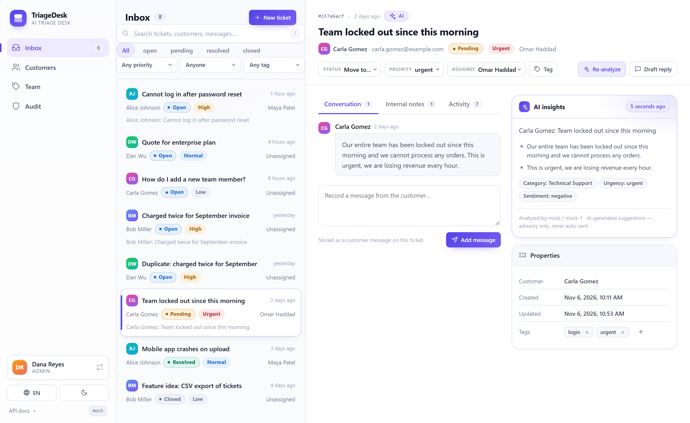

# TriageDesk

**An AI triage desk for customer inquiries.** LLM structured outputs summarize, categorize and prioritize incoming messages, while a working support desk on the same SQLite database handles customers, tickets, tags, assignment, internal notes, history, search, audit and RBAC. Ships with a bilingual web UI, a CLI, a REST API and 300 offline tests.



**Documentation:** [English](README.md) · [简体中文](README.zh-CN.md)

`Python 3.11+` · `FastAPI` · `OpenAI SDK (structured outputs)` · `SQLite` · `pytest (offline)` · `Docker` · zero-build vanilla JS UI

> Independent portfolio project. The OpenAI integration is fully implemented and tested against a fake SDK, but the default test/demo path never touches the network. Demo mode needs no credentials. Built-in authentication is a development mechanism, not production identity management. **AI output is advisory** (`ai_*` fields): classifications and drafts for human review, never auto-sent and never presented as decided facts.

---

## Why the rename

The project started as **AI Inquiry Processor** — a CSV → LLM → CSV triage script. It has since grown into a support desk with tickets, agents, workflow and a web UI, so the old name described only the first stage. It is now **TriageDesk**: *triage* is the core job, *desk* is the product.

What changed: package and distribution name (`triagedesk`), CLI command (`triagedesk`), app title, Docker image/service names, documentation, and the `TRIAGEDESK_*` environment prefix. The old `AI_INQUIRY_*` variables are still accepted so existing `.env` files keep working. The GitHub repository is still named `ai-inquiry-processor` until you rename it in the repository settings — update the clone URL when you do.

---

## Quick start

```bash
git clone https://github.com/taozhihaoo/ai-inquiry-processor.git
cd ai-inquiry-processor

python -m venv .venv
# Windows: .venv\Scripts\Activate.ps1    macOS/Linux: source .venv/bin/activate
pip install -r requirements.txt

python -m src.desk.seed --lang en        # fictional demo data, fully offline
uvicorn src.api:app --host 127.0.0.1 --port 8000
```

Open **http://127.0.0.1:8000/** for the UI, or **http://127.0.0.1:8000/docs** for Swagger. On first visit, pick one of the seeded agent identities (see [Development authentication](#development-authentication)). The server defaults to the `mock` provider, so everything works without an API key.

For a Chinese demo dataset, run `python -m src.desk.seed --lang zh --reset` before starting the server.

## Web UI

The UI is served by FastAPI from `src/desk/web/` — plain HTML/CSS/JS, no bundler, no CDN, no Node.js. The Chinese interface is shown in the [中文 README](README.zh-CN.md).

- **Inbox** — filter by status, priority, assignee and tag; full-text search; a three-pane layout with ticket list, conversation and an AI insights panel.
- **Ticket workflow** — move through `open → pending → resolved → closed` (invalid transitions are rejected by the API), assign/unassign, manage tags, record customer messages and internal notes, and read the activity timeline.
- **AI actions** — analyze a ticket (summary, key points, category, suggested priority, urgency, sentiment) or generate a reply draft. Results are labelled advisory; the draft can be copied but is never sent.
- **Customers, Team, Audit** — customer directory, agents and tags, and an admin-only audit log.
- **Bilingual + themes** — switch between English and 简体中文 and between light and dark in the sidebar; the choice is remembered in `localStorage`.
- **Responsive** — desktop three-pane layout collapses to a single column on narrow screens.

## CLI — inquiry triage pipeline

The original CSV pipeline is still available (and installable as a console script):

```bash
triagedesk --demo                              # offline deterministic mock provider
triagedesk --version
triagedesk -i inquiries.csv -o output --format both
python -m src.main --demo --db data/demo.db    # equivalent module invocation
```

The CLI loads a CSV with `customer_name,message` columns, persists every result to SQLite with idempotent content hashes, and writes JSON + CSV reports. Without `--demo` it uses the `openai` provider and requires `OPENAI_API_KEY`.

## REST API

Interactive docs at `/docs`. All desk endpoints require the `X-Agent-Id` development header.

```
GET    /health                          liveness + provider
POST   /inquiries                       triage one inquiry (idempotent)
POST   /inquiries/batch                 batch triage (max 1000 items)
GET    /inquiries/{id}                  stored result

GET    /auth/dev/agents                 demo identities for the UI (no auth)
GET    /tickets                         inbox: status, priority, assignee, tag, search…
POST   /tickets                         create (409 on duplicate content)
GET    /tickets/{id}                    ticket + customer + assignee + tags + messages
PATCH  /tickets/{id}                    status / priority / subject
POST   /tickets/{id}/assign | /unassign
POST   /tickets/{id}/messages | /notes | /tags
GET    /tickets/{id}/notes | /tags | /history
POST   /tickets/{id}/ai/analyze | /ai/suggest-reply
GET    /customers   POST /customers    GET /customers/{id}/tickets
GET    /tags        POST /tags         (admin)
GET    /agents      POST /agents       (admin)
GET    /audit                          (admin)
```

Status codes: `200/201/204` success · `400` validation · `401` missing/unknown/inactive agent · `403` insufficient role · `404` unknown entity · `409` duplicate / invalid transition · `422` malformed body / invalid filter · `502` provider failure. Errors are always `{"error": {"code", "message"}}` — no tracebacks, no internals.

## Architecture

```
   Browser (bilingual SPA)          CLI (triagedesk)        Swagger / HTTP client
            │                              │                        │
            └──────────────┬───────────────┴────────────────────────┘
                           ▼
              FastAPI  src/api.py  ·  src/desk/api.py
              (transport: validation, dev auth, error mapping)
                           │
             ┌─────────────┴─────────────┐
             ▼                           ▼
      InquiryService              DeskService
      (idempotent triage)         (workflow · RBAC · dedup · audit)
             │                           │
             └─────────────┬─────────────┘
                           ▼
        LLMClient protocol → OpenAIClient (strict json_schema,
        retry/backoff) | MockLLMClient (deterministic, offline)
                           ▼
           SQLite (one file): inquiries + processing_runs
             + customers / agents / tags / tickets / messages
               / notes / ticket_tags / ticket_events / audit_log
```

Layering rules: the API never writes SQL and never calls a provider; services never import FastAPI; all AI goes through `LLMClient`. Schema creation is idempotent, so a database from an earlier version keeps its data and only gains tables.

## Data model

| Table | Key fields |
| --- | --- |
| `customers` | `id`, `name`, `email` (unique), `external_id?`, timestamps |
| `agents` | `id`, `name`, `email` (unique), `role` (`agent`/`admin`), `active` |
| `tags` | `id`, `name` (unique, case-insensitive) |
| `tickets` | `id`, `customer_id`, `subject`, `status`, `priority`, `assignee_id?`, `content_hash`, `resolved_at?`, advisory `ai_*` fields, timestamps |
| `ticket_messages` | `id`, `ticket_id`, `author_type` (`customer`/`agent`/`system`), `body`, `content_hash` |
| `internal_notes` | `id`, `ticket_id`, `author_id`, `author_name`, `body` |
| `ticket_tags` | (`ticket_id`, `tag_id`) composite primary key |
| `ticket_events` | `id`, `ticket_id`, `event_type`, `actor_id?`, JSON metadata |
| `audit_log` | `id`, `actor_id?`, `action`, `entity_type`, `entity_id`, JSON metadata |

Vocabularies: status `open/pending/resolved/closed` · priority and urgency `low/normal/high/urgent` · sentiment `positive/neutral/negative` · category `Sales / Technical Support / Billing / General Question`. All SQL is parameterized, foreign keys are enforced, and connections use WAL plus a busy timeout.

## Demo data

`python -m src.desk.seed` seeds 3 agents, 4 customers, 6 tags and 8 tickets across all statuses and priorities, with 3 AI analyses, 1 AI reply draft, 2 internal notes and one deliberate duplicate-detection case. `--lang en|zh` picks the language, `--db PATH` the database, `--reset` wipes only the desk tables (inquiry rows are kept) and reseeds. Timestamps are staggered so the inbox reads like a real queue. Seeding is idempotent: a second run does nothing.

## AI capabilities

| Operation | Path | Output (advisory) |
| --- | --- | --- |
| Ticket analysis | `POST /tickets/{id}/ai/analyze` → `DeskService` → `desk.ai` → `LLMClient.complete_structured` | summary, 1–5 key points, category, suggested priority, urgency, sentiment |
| Suggested reply | `POST /tickets/{id}/ai/suggest-reply` | draft text from the latest customer message; stored as `ai_reply`, never auto-sent |
| Inquiry triage | CLI / `POST /inquiries` | summary, category, priority |

Every call pins a strict `json_schema` response format **and** re-validates the payload against fixed vocabularies before persistence. The mock provider implements the same schemas deterministically (English + Chinese keyword heuristics), so demos, tests and CI run fully offline; usage fields stay `null` for the mock — no invented token counts.

## Roles and permissions

| Capability | agent | admin |
| --- | --- | --- |
| View tickets, customers, tags, agents; search | ✅ | ✅ |
| Modify a ticket | unassigned or own tickets | any ticket |
| Add notes/messages, use AI, create customers | ✅ | ✅ |
| Create agents, create tags, read audit log | ❌ | ✅ |

### Development authentication

Send `X-Agent-Id: <agent id>`; the UI offers a picker backed by `GET /auth/dev/agents`, which exposes only id/name/role of active agents. Unknown, missing or inactive ids get `401`, insufficient role gets `403`. **This is not production authentication** — no OAuth, no JWT, no SSO, no secrets. Put the service behind a real gateway for anything real.

## Configuration

See [`.env.example`](.env.example). App-owned settings use `TRIAGEDESK_*`; the legacy `AI_INQUIRY_*` names still work.

| Variable | Default | Purpose |
| --- | --- | --- |
| `LLM_PROVIDER` / `TRIAGEDESK_PROVIDER` | `mock` for the server, `openai` for a bare CLI run | `openai` or `mock` |
| `OPENAI_API_KEY` | — | required only for real OpenAI calls |
| `OPENAI_MODEL` | `gpt-4o-mini` | model name |
| `OPENAI_BASE_URL` | — | compatible endpoint override |
| `LLM_TIMEOUT_SECONDS`, `LLM_MAX_RETRIES`, `LLM_RETRY_INITIAL_DELAY`, `LLM_RETRY_MAX_DELAY` | `30`, `3`, `1.0`, `10.0` | timeout and exponential backoff |
| `TRIAGEDESK_DB_PATH` | `data/triagedesk.db` | SQLite file |
| `TRIAGEDESK_OUTPUT_DIR` | `output` | CLI reports |
| `LLM_PRICE_INPUT_PER_MTOK`, `LLM_PRICE_OUTPUT_PER_MTOK` | unset | optional cost estimate; `estimated_cost` stays `null` unless both prices and real usage exist |

Token usage is stored only when the provider reports it; `estimated_cost` is an estimate, never a billing figure.

## Testing and CI

```bash
pytest           # 300 tests, fully offline: fake SDK, mock LLM, temp SQLite
ruff check .     # lint (CI enforces)
```

GitHub Actions runs on Python 3.11 / 3.12 / 3.13: lint, import check, migration tests, both demo-language seed runs (each twice), the full suite, a UI/API smoke test, a wheel build that verifies `src.desk` and all web assets are packaged, and a `triagedesk --version` console-script check. No job has credentials.

## Running with Docker

```bash
docker compose up          # mock provider; UI at http://127.0.0.1:8000/
curl http://127.0.0.1:8000/health
```

Non-root container, named volumes for `/app/data` and `/app/output`, healthcheck on `/health`. `.env` is never baked into the image; inject secrets at runtime:

```bash
LLM_PROVIDER=openai OPENAI_API_KEY=sk-... docker compose up
```

*Docker configuration is provided but was not executed in the environment where this README was written.*

## Current limitations

Stated plainly:

- **Development authentication only** (`X-Agent-Id`); no identity provider.
- **SQLite, single process** — right for this scale; multi-instance writes need a real database server.
- **Synchronous AI calls** — no background workers; batch endpoints are bounded (1000 items in the API).
- **Duplicate detection is hash-based** (customer + normalized message), not semantic.
- **The OpenAI path was not verified against the live API** in this environment; Docker was not executed either.
- Not "production-ready" or "battle-tested" — a well-tested, honestly scoped portfolio project.

## Security

- API keys come only from environment variables; they are never hardcoded, logged or returned.
- All SQL is parameterized; foreign keys are on; user search wildcards are escaped.
- Customer text travels as JSON data with a fixed system prompt; prompt-injection attempts cannot alter instructions, and a test covers this.
- AI payloads are re-validated against fixed vocabularies before persistence.
- Error responses are structured and opaque — no tracebacks, no provider internals.
- The audit log stores whitelisted metadata only.
- `data/`, `output/` and `.env` are git-ignored; demo data is fictional.
- Development authentication is explicitly not production authentication.

## License

[MIT](LICENSE)
