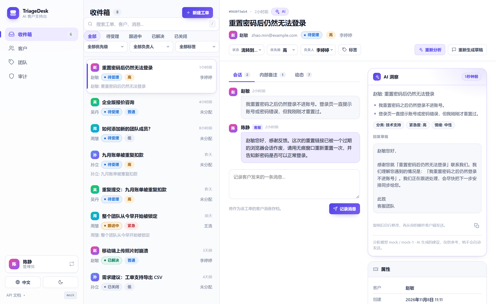

# TriageDesk

**面向客户咨询的 AI 工单分诊台。** 通过 LLM 结构化输出对来信做摘要、分类与优先级判定，同时在同一个 SQLite 数据库上提供完整的客服工单系统：客户、工单、标签、分配、内部备注、历史、搜索、审计与角色权限。自带中英双语 Web 界面、CLI、REST API，以及 300 个离线测试。



**文档：** [English](README.md) · [简体中文](README.zh-CN.md)

`Python 3.11+` · `FastAPI` · `OpenAI SDK（结构化输出）` · `SQLite` · `pytest（离线）` · `Docker` · 免构建的原生 JS 界面

> 独立作品集项目。OpenAI 接入已完整实现，并通过伪造 SDK 测试，但默认的测试 / 演示路径不会访问网络。演示模式不需要任何密钥。内置的身份认证是开发期机制，不是生产级身份认证。**AI 输出仅为建议**（`ai_*` 字段）：分类与草稿供人工复核，绝不自动发送，也不会被当作已确认的事实。

---

## 为什么改名

项目最初叫 **AI Inquiry Processor**，本质是一个 CSV → LLM → CSV 的分诊脚本。后来它长成了带工单、客服、状态流转和 Web 界面的支持台，旧名字只能描述最初的一环。现在叫 **TriageDesk**：*Triage*（分诊）是核心能力，*Desk*（工作台）是产品形态。

已同步修改：包名与发行名（`triagedesk`）、CLI 命令（`triagedesk`）、应用标题、Docker 服务名、全部文档，以及 `TRIAGEDESK_*` 环境变量前缀。旧的 `AI_INQUIRY_*` 变量仍然兼容，已有的 `.env` 无需改动。GitHub 仓库目前仍叫 `ai-inquiry-processor`，需要你在仓库设置里自行改名；改名后请同步更新下面的克隆地址。

---

## 快速开始

```bash
git clone https://github.com/taozhihaoo/ai-inquiry-processor.git
cd ai-inquiry-processor

python -m venv .venv
# Windows: .venv\Scripts\Activate.ps1    macOS/Linux: source .venv/bin/activate
pip install -r requirements.txt

python -m src.desk.seed --lang zh        # 离线写入虚构的中文演示数据
uvicorn src.api:app --host 127.0.0.1 --port 8000
```

浏览器打开 **http://127.0.0.1:8000/** 使用界面，或打开 **http://127.0.0.1:8000/docs** 查看 Swagger。首次进入时选择一个预置客服身份（见[开发期身份认证](#开发期身份认证)）。服务端默认使用 `mock` provider，因此无需 API Key 即可完整体验。

如需英文演示数据，启动前执行 `python -m src.desk.seed --lang en --reset` 即可。

## Web 界面

界面由 FastAPI 直接从 `src/desk/web/` 提供 —— 原生 HTML / CSS / JS，没有打包器、没有 CDN、不需要 Node.js。英文界面见 [English README](README.md)。

- **收件箱** —— 按状态、优先级、负责人、标签筛选；全文搜索；列表 + 会话 + AI 洞察三栏布局。
- **工单流转** —— `待受理 → 跟进中 → 已解决 → 已关闭`（非法流转由 API 拒绝）、分配 / 取消分配、标签管理、记录客户消息与内部备注、查看动态时间线。
- **AI 操作** —— 分析工单（摘要、要点、分类、建议优先级、紧急度、情绪），或生成回复草稿。结果明确标注仅供参考，草稿可以复制，但绝不会自动发送。
- **客户 / 团队 / 审计** —— 客户目录、客服与标签管理，以及仅管理员可见的审计日志。
- **双语与主题** —— 侧栏可切换 English / 简体中文、浅色 / 深色，选择会记在 `localStorage` 里。
- **响应式** —— 桌面三栏，窄屏自动折叠为单栏。

## CLI —— 咨询分诊流水线

最初的 CSV 流水线仍然保留，也可以作为命令行程序安装：

```bash
triagedesk --demo                              # 离线、确定性的 mock provider
triagedesk --version
triagedesk -i inquiries.csv -o output --format both
python -m src.main --demo --db data/demo.db    # 等价的模块调用方式
```

CLI 读取含 `customer_name,message` 两列的 CSV，用内容哈希做幂等持久化，并输出 JSON + CSV 报告。不加 `--demo` 时使用 `openai` provider，需要 `OPENAI_API_KEY`。

## REST API

交互式文档位于 `/docs`。除 `/auth/dev/agents` 外，所有工单台接口都需要 `X-Agent-Id` 开发期请求头。

```
GET    /health                          健康检查 + provider 信息
POST   /inquiries                       单条咨询分诊（幂等）
POST   /inquiries/batch                 批量分诊（最多 1000 条）
GET    /inquiries/{id}                  查询已存结果

GET    /auth/dev/agents                 界面用的演示身份列表（无需鉴权）
GET    /tickets                         收件箱：状态、优先级、负责人、标签、搜索…
POST   /tickets                         新建工单（内容重复返回 409）
GET    /tickets/{id}                    工单 + 客户 + 负责人 + 标签 + 消息
PATCH  /tickets/{id}                    状态 / 优先级 / 主题
POST   /tickets/{id}/assign | /unassign
POST   /tickets/{id}/messages | /notes | /tags
GET    /tickets/{id}/notes | /tags | /history
POST   /tickets/{id}/ai/analyze | /ai/suggest-reply
GET    /customers   POST /customers    GET /customers/{id}/tickets
GET    /tags        POST /tags         （管理员）
GET    /agents      POST /agents       （管理员）
GET    /audit                          （管理员）
```

状态码：`200/201/204` 成功 · `400` 校验失败 · `401` 身份缺失 / 未知 / 停用 · `403` 角色权限不足 · `404` 对象不存在 · `409` 重复工单 / 非法流转 · `422` 请求体格式错误 / 无效筛选参数 · `502` provider 失败。错误统一为 `{"error": {"code", "message"}}`，不泄露堆栈与内部信息。

## 架构

```
   浏览器（双语 SPA）            CLI (triagedesk)          Swagger / HTTP 客户端
            │                          │                          │
            └────────────┬─────────────┴──────────────────────────┘
                         ▼
            FastAPI  src/api.py  ·  src/desk/api.py
            （传输层：参数校验、开发期鉴权、错误映射）
                         │
           ┌─────────────┴─────────────┐
           ▼                           ▼
    InquiryService              DeskService
    （幂等分诊）                （状态机 · RBAC · 去重 · 审计）
           │                           │
           └─────────────┬─────────────┘
                         ▼
      LLMClient 协议 → OpenAIClient（严格 json_schema、
      重试 / 退避）| MockLLMClient（确定性、离线）
                         ▼
        SQLite（单文件）：inquiries + processing_runs
          + customers / agents / tags / tickets / messages
            / notes / ticket_tags / ticket_events / audit_log
```

分层约束：API 不写 SQL、不直接调用 provider；service 不 import FastAPI；所有 AI 调用都经过 `LLMClient`。建表是幂等的，旧版本数据库会保留数据、只新增表。

## 数据模型

| 表 | 主要字段 |
| --- | --- |
| `customers` | `id`、`name`、`email`（唯一）、`external_id?`、时间戳 |
| `agents` | `id`、`name`、`email`（唯一）、`role`（`agent`/`admin`）、`active` |
| `tags` | `id`、`name`（唯一，大小写不敏感） |
| `tickets` | `id`、`customer_id`、`subject`、`status`、`priority`、`assignee_id?`、`content_hash`、`resolved_at?`、建议性 `ai_*` 字段、时间戳 |
| `ticket_messages` | `id`、`ticket_id`、`author_type`（`customer`/`agent`/`system`）、`body`、`content_hash` |
| `internal_notes` | `id`、`ticket_id`、`author_id`、`author_name`、`body` |
| `ticket_tags` | (`ticket_id`, `tag_id`) 复合主键 |
| `ticket_events` | `id`、`ticket_id`、`event_type`、`actor_id?`、JSON 元数据 |
| `audit_log` | `id`、`actor_id?`、`action`、`entity_type`、`entity_id`、JSON 元数据 |

取值域：状态 `open/pending/resolved/closed` · 优先级与紧急度 `low/normal/high/urgent` · 情绪 `positive/neutral/negative` · 分类 `Sales / Technical Support / Billing / General Question`。所有 SQL 均参数化，外键强制开启，连接启用 WAL 与 busy timeout。

## 演示数据

`python -m src.desk.seed` 会写入 3 名客服、4 位客户、6 个标签、8 张覆盖各种状态与优先级的工单，其中包含 3 条 AI 分析、1 份回复草稿、2 条内部备注，以及一个刻意设计的重复工单案例。`--lang en|zh` 选择语言，`--db PATH` 指定数据库，`--reset` 只清空工单台相关表（保留 inquiries）后重新写入。时间戳经过错开处理，收件箱看起来像真实队列。写入是幂等的：再次执行不会重复创建。

## AI 能力

| 操作 | 调用路径 | 输出（建议性） |
| --- | --- | --- |
| 工单分析 | `POST /tickets/{id}/ai/analyze` → `DeskService` → `desk.ai` → `LLMClient.complete_structured` | 摘要、1–5 条要点、分类、建议优先级、紧急度、情绪 |
| 回复草稿 | `POST /tickets/{id}/ai/suggest-reply` | 基于最新客户消息生成草稿，存为 `ai_reply`，绝不自动发送 |
| 咨询分诊 | CLI / `POST /inquiries` | 摘要、分类、优先级 |

每次调用都固定使用严格 `json_schema` 响应格式，并在持久化前按固定取值域再次校验结果。mock provider 以确定性规则实现同样的 schema（中英文关键词启发式），因此演示、测试和 CI 全程离线；mock 的 usage 字段保持 `null`，绝不编造 token 数。

## 角色与权限

| 能力 | 客服 agent | 管理员 admin |
| --- | --- | --- |
| 查看工单、客户、标签、客服；搜索 | ✅ | ✅ |
| 修改工单 | 未分配或属于自己的工单 | 任意工单 |
| 添加备注 / 消息、使用 AI、创建客户 | ✅ | ✅ |
| 创建客服、创建标签、查看审计日志 | ❌ | ✅ |

### 开发期身份认证

请求头发送 `X-Agent-Id: <agent id>`；界面通过 `GET /auth/dev/agents` 提供身份选择，该接口只返回启用中客服的 id / 姓名 / 角色。身份缺失、未知或停用返回 `401`，角色权限不足返回 `403`。**这不是生产级认证** —— 没有 OAuth、JWT、SSO，也没有密钥。真实部署请在前面接入自己的网关与身份系统。

## 配置

参见 [`.env.example`](.env.example)。应用自有配置使用 `TRIAGEDESK_*` 前缀，旧的 `AI_INQUIRY_*` 依然兼容。

| 变量 | 默认值 | 用途 |
| --- | --- | --- |
| `LLM_PROVIDER` / `TRIAGEDESK_PROVIDER` | 服务端 `mock`，直接运行 CLI 时 `openai` | `openai` 或 `mock` |
| `OPENAI_API_KEY` | — | 仅真实调用 OpenAI 时需要 |
| `OPENAI_MODEL` | `gpt-4o-mini` | 模型名 |
| `OPENAI_BASE_URL` | — | 兼容接口的自定义地址 |
| `LLM_TIMEOUT_SECONDS`、`LLM_MAX_RETRIES`、`LLM_RETRY_INITIAL_DELAY`、`LLM_RETRY_MAX_DELAY` | `30`、`3`、`1.0`、`10.0` | 超时与指数退避 |
| `TRIAGEDESK_DB_PATH` | `data/triagedesk.db` | SQLite 文件 |
| `TRIAGEDESK_OUTPUT_DIR` | `output` | CLI 报告目录 |
| `LLM_PRICE_INPUT_PER_MTOK`、`LLM_PRICE_OUTPUT_PER_MTOK` | 未设置 | 可选成本估算；只有价格与真实 usage 都存在时 `estimated_cost` 才有值 |

只有 provider 上报 usage 时才会记录 token；`estimated_cost` 只是估算，不是账单数字。

## 测试与 CI

```bash
pytest           # 300 个测试，全程离线：伪造 SDK、mock LLM、临时 SQLite
ruff check .     # lint（CI 强制）
```

GitHub Actions 覆盖 Python 3.11 / 3.12 / 3.13：lint、导入检查、迁移测试、两种语言的演示数据各写入两次、完整测试套件、UI / API 冒烟、构建 wheel 并校验 `src.desk` 与全部前端资源确实被打进包里，以及 `triagedesk --version` 命令行入口检查。所有任务都没有凭据。

## 使用 Docker 运行

```bash
docker compose up          # mock provider；界面 http://127.0.0.1:8000/
curl http://127.0.0.1:8000/health
```

容器以非 root 用户运行，`/app/data` 与 `/app/output` 使用命名卷，`/health` 提供健康检查。`.env` 不会被打进镜像；请在运行时注入密钥：

```bash
LLM_PROVIDER=openai OPENAI_API_KEY=sk-... docker compose up
```

*仓库提供 Docker 配置，但编写本 README 的环境中并未实际执行。*

## 当前限制

如实说明：

- **仅开发期身份认证**（`X-Agent-Id`），没有真正的身份系统。
- **SQLite、单进程** —— 适配当前规模；多实例并发写入需要真正的数据库服务。
- **AI 调用是同步的** —— 没有后台任务队列；批量接口有上限（API 为 1000 条）。
- **重复检测基于哈希**（客户 + 归一化文本），不是语义相似度。
- **本环境未对真实 OpenAI API 做联网验证**，也未执行 Docker。
- 不是「生产就绪」或「久经考验」的系统 —— 这是一个测试充分、范围诚实的作品集项目。

## Security

- API keys come only from environment variables; they are never hardcoded, logged or returned.
- All SQL is parameterized; foreign keys are on; user search wildcards are escaped.
- Customer text travels as JSON data with a fixed system prompt; prompt-injection attempts cannot alter instructions, and a test covers this.
- AI payloads are re-validated against fixed vocabularies before persistence.
- Error responses are structured and opaque — no tracebacks, no provider internals.
- The audit log stores whitelisted metadata only.
- `data/`, `output/` and `.env` are git-ignored; demo data is fictional.
- Development authentication is explicitly not production authentication.

## License

[MIT](LICENSE)
